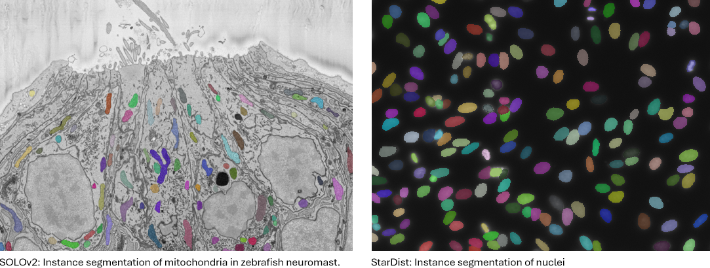
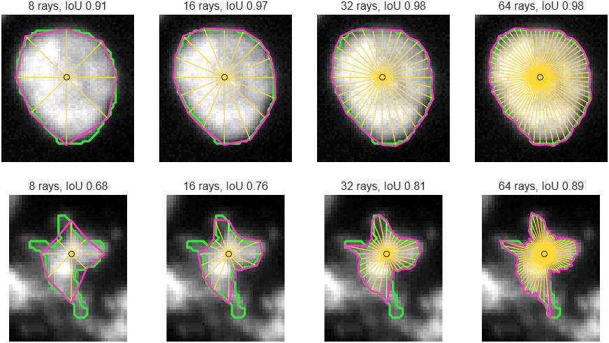
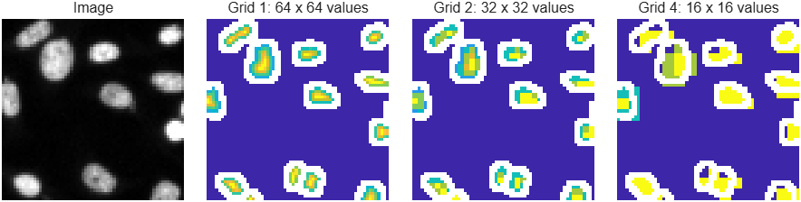
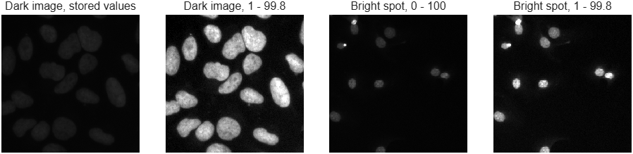
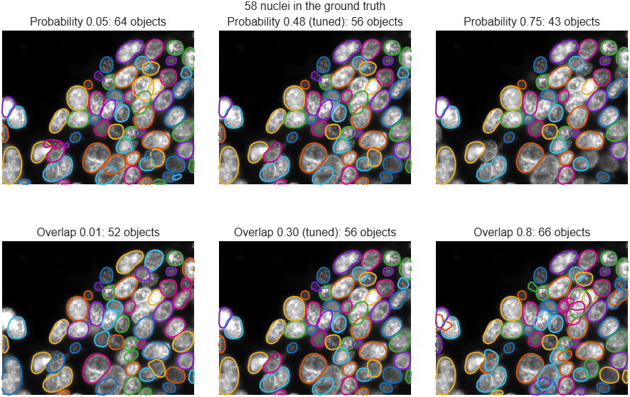
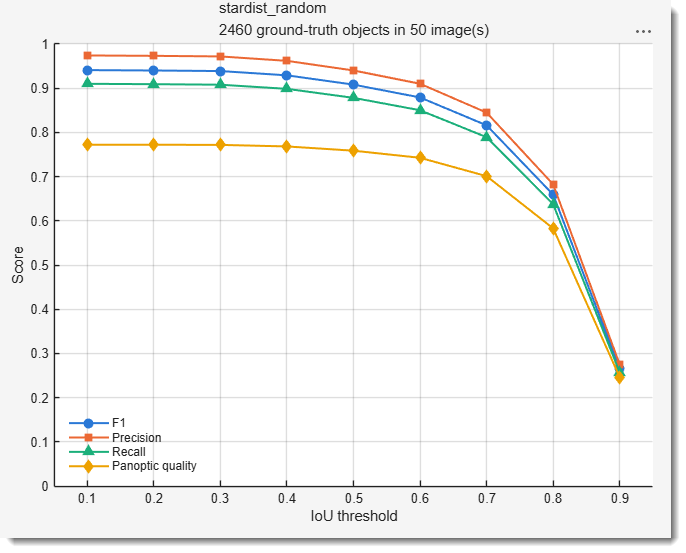
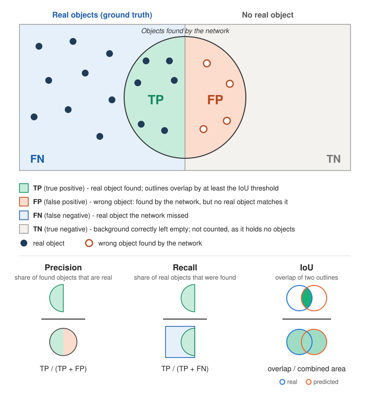

# Deep MIB - 2D Instance Segmentation (SOLOv2, StarDist)

Training and application of networks that find every object individually in 2D images. Two
architectures are available; choose by the shape of the objects:

- [**SOLOv2**](#solov2) - objects of any shape: elongated, branched, bent or irregular, such as
  cells with protrusions or organelles.
- [**StarDist**](#stardist) - round or oval objects, such as nuclei, round cells or vesicles,
  also when they are packed densely and touch each other. A pretrained model for
  fluorescent nuclei can be [used without training](#stardist-prediction-without-training), or
  fine-tuned with few annotated images.

{.on-glb align=left width="600"}
/// caption
Examples of 2D instance segmentation using SOLOv2 and StarDist architectures
///

---

## Overview

Unlike the semantic workflows, which assign every pixel to a *class* (all objects of the same
type share one label), **instance segmentation** detects each object *individually*: every
object receives its own distinct label, so touching or overlapping objects of the same type are
separated.

The procedure follows the same three phases as the other workflows, with one difference:
instance segmentation **requires a preprocessing step** before training.

1. **Preprocess** the ground-truth models into instance label files (*Directories and
   Preprocessing tab*, see [Preprocessing](#preprocessing-required-for-training)).
2. **Train** the network (*Train tab*, see [Training](#training)).
3. **Predict** new datasets and export the detected objects as MIB models (*Predict tab*, see
   [Prediction](#prediction)). The result can then be
   [evaluated](#evaluating-the-predictions) against ground-truth labels, and objects predicted on
   serial sections can be [merged into 3D objects](#merging-2d-predictions-into-a-3d-model).

For nuclei in fluorescence images, StarDist can skip steps 1 and 2, see
[StarDist: prediction without training](#stardist-prediction-without-training).

---

## Architectures

| | SOLOv2 | StarDist |
|---|---|---|
| Object shapes | any | round or oval |
| Image channels | 3; grayscale images are converted to RGB | as in the images, e.g. 1 for grayscale |
| Starting weights | pretrained on everyday photos (COCO) | pretrained on fluorescent nuclei, or random |
| Large images | processed in tiles, objects stitched across the tiles | processed in tiles, nothing to stitch |
| Requires | *SOLO V2* support package | - |

### SOLOv2

SOLOv2 (*Segmenting Objects by Locations*) places a grid over the image. Every grid cell that holds
the centre of an object predicts the whole mask of that object, together with a confidence score;
masks predicted more than once for the same object are removed. The image features come from a
ResNet encoder (Resnet18 or Resnet50) pretrained on COCO, a large collection of everyday
photographs. Because the masks are predicted directly, the objects may have any shape.

!!! warning "Support package required"

    SOLOv2 requires the *Computer Vision Toolbox Model for SOLO V2 Instance Segmentation*
    support package. To install this support package, use the **Add-On Explorer**.

### StarDist

StarDist uses a U-Net that predicts two maps for every pixel: the probability that the pixel lies
inside an object, highest at the object centre, and the distances from the pixel to the object edge
along a fixed set of directions (rays). Every pixel with a high probability thereby proposes a
star-shaped polygon, and of the overlapping proposals of one object only the most confident is
kept. Touching objects separate well, because each has its own centre.

The polygons work for **star-convex** objects, whose whole edge can be seen in a straight line from
the centre: round or oval shapes. For objects with arms, holes or strongly bent shapes use SOLOv2.
Whether your objects suit StarDist can be tested on the training labels, see
[Starting weights](#starting-weights).

---

## Compatible source datasets

- **Images**: 2D images.
    - **SOLOv2**: 1 (grayscale) or 3 (RGB) colour channels; grayscale images are converted to RGB
      automatically.
    - **StarDist**: any number of colour channels, the same in all images; the images are used with
      their own channels.
- **Ground-truth labels**: a MIB `.model` file per image (or a single `.model` file for all
  images when <label class="widget widget-checkbox">Single MIB model file</label> is checked),
  in which **each individual object is painted with its own unique index** (`1, 2, 3, ...`) and
  the background is `0`. Touching objects must use different indices to be separated. `uint8`
  models allow up to 255 objects per image; `uint16` models allow many more.
- **Classes**: the current implementation is **single-class** - every detected object belongs to
  one class named `object`. The Number of classes field
  is not used for this workflow.

!!! tip "Preparing instance labels"

    Paint each object with its own index in the MIB model, for example using the watershed /
    object-separation tools.

---

## Network panel

In the [Network panel](deepmib-networks.md) select:

- Workflow: **2D Instance**
- Architecture: **SOLOv2** or **StarDist**
- Encoder:
    - **SOLOv2**: **Resnet18** (lighter, faster) or **Resnet50** (heavier, potentially more
      accurate). These map to the pretrained `light-resnet18-coco` and `resnet50-coco` backbones.
    - **StarDist**: not used.

The Input patch size is given as
`height width depth colors`; the depth is always `1`. This size defines the **patch** cropped
during training: images are processed at native resolution, not downscaled as a whole.

- **SOLOv2**: width and height multiples of **32**, colours `3`, for example `800 800 1 3`. The
  same size is used for the tiles during prediction.
- **StarDist**: width and height multiples of **16** (32 with a grid of 4), colours equal to the
  number of colour channels of the images, for example `256 256 1 1` for grayscale images. The
  tiles used during prediction are set separately, see [Prediction](#prediction).

!!! note

    Use a **square** input patch size if you intend to enable the 90° rotation augmentations
    (see the [Train tab](deepmib-train.md)); non-square patches are not compatible with those
    augmentations.

---

## StarDist: prediction without training

The pretrained StarDist model **2D_versatile_fluo** segments nuclei in fluorescence images and can
be used as it is: no ground-truth labels, preprocessing or training are needed.

1. In the [Network panel](deepmib-networks.md) select the **2D Instance** workflow and the
   **StarDist** architecture.
2. Confirm **Create network from pretrained** in the dialog that follows and choose a name for the
   network file. Later, the same is available in the StarDist settings (the settings button next
   to Starting weights): tick
   **Create a network file from the pretrained model**.
3. If your nuclei are not about 20 pixels in diameter, set
   Downsample factor for images on the
   [Predict tab](deepmib-predict.md), see below.
4. Segment the images as with a trained network, see [Prediction](#prediction).

The model was trained on nuclei of about 20 pixels in diameter, most of them between 10 and 50
pixels, and works best on nuclei of that size. Measure the diameter of a few typical nuclei in your
images and set Downsample factor for images to
`diameter / 20`: for example `2` for nuclei of 40 pixels, `0.5` for nuclei of 10 pixels. The
results are returned at the original image size.

The model expects single-channel images. If it finds too many or too few nuclei, adjust the
detection thresholds with **Custom** in the prediction settings. If it still misses, merges or
splits nuclei, annotate a few images and fine-tune the model, see
[Starting weights](#starting-weights).

---

## Preprocessing (required for training)

Instance segmentation does not train directly on MIB `.model` files: preprocessing first
converts each model into a lightweight MAT-file that stores the 2-D instance label map.
Training then crops native-resolution patches from these maps on-the-fly. Preprocessing is the
same for both architectures.

**To preprocess for training:**

1. Arrange the training data under the *training* directory (named `1_Training` in the
   [directory schemes](deepmib-dirs.md#organization-of-directories)):
    - `Images/` - the training images
    - `Labels/` - the corresponding `.model` files (one per image, or a single model file)
2. Set Preprocess for to **Training**.
3. Press Preprocess. Deep MIB converts the models into
   `LabelsInstances/*.mat` and then offers to **split the files into training and validation
   sets**. Choosing *Split labels* creates the `TrainImages`, `TrainLabels`, `ValidationImages`
   and `ValidationLabels` subfolders used during training.

Preprocessing writes **one `.mat` per input image** (so the file count matches the number of
input models), splitting them into the `TrainLabels`/`ValidationLabels` folders.

??? abstract "Preprocessed label file format (`LabelsInstances/*.mat`)"

    Each MAT-file is lightweight and contains only two variables:

    | Variable | Type | Description |
    |----------|------|-------------|
    | `imageFilename` | `char` | name of the source image (e.g. `00001.png`), used to locate the image in `TrainImages` / `ValidationImages` |
    | `instanceLabelMap` | `H×W uint16` | 2-D label map - each object a unique index, background `0` |

    Storing a compact 2-D label map (instead of a full `H×W×N` binary mask stack) keeps memory
    usage low for large / whole-slide images. Native-resolution training patches are cropped from
    this map on-the-fly.

!!! info "Prediction needs no preprocessing"

    Only *training* requires preprocessing. For **prediction** the network reads the raw images
    directly: place the images to segment in the prediction directory (`2_Prediction/Images`) and
    run the [Predict tab](deepmib-predict.md).

---

## Training

Training is configured and started from the [Train tab](deepmib-train.md).

### Starting weights

Starting weights:

- **SOLOv2** always starts from the COCO weights; the choice is what happens to the encoder during
  training: `COCO, frozen then trainable` (default, recommended), `COCO, frozen backbone` or
  `COCO, trainable backbone`. See the [Train tab](deepmib-train.md) for details.
- **StarDist**:
    - **2D_versatile_fluo** - fine-tune the pretrained StarDist model for fluorescent nuclei
      (grayscale images). It is downloaded the first time it is used. Fine-tuning needs far fewer
      annotated images than training from scratch.
    - **None (random)** - train a new network.

The settings button next to Starting weights:

- **SOLOv2**: the schedule of the two-phase `COCO, frozen then trainable` training, see the
  [Train tab](deepmib-train.md).
- **StarDist**: the StarDist settings:
    - **Number of rays** and **Grid** - used for a new network only; a pretrained model keeps its
      own (32 rays, grid 2). More rays follow the outline more closely. A grid of 2 trains faster
      and suits most objects; use 1 for very small objects.
    
        ??? example "Number of rays: how closely the outline is followed"
    
            Each object is drawn as a polygon whose corners lie on rays from its centre (yellow lines);
            green is the true outline. A round nucleus is matched almost perfectly with 16 to 32 rays.
            An irregular shape stays inaccurate even with 64 rays: parts that cannot be seen in a straight
            line from the centre are cut off. 32 rays suit most nuclei.
        
            {.on-glb width="800"}

        ??? example "Grid: the resolution of the predicted maps"

            The network predicts its maps at `1/grid` of the image resolution; the picture shows the
            probability map it learns, brighter towards the object centres. Grid 2 trains and predicts
            faster and suits most nuclei. The coarser the grid, the fewer values cover a small object; for
            objects of only a few pixels across use grid 1.
        
            {.on-glb width="800"}

    - **Normalisation percentiles** - the image intensities are stretched between these percentiles
      of each image. Keep the default `1` and `99.8` when fine-tuning a pretrained model.

        ??? example "Normalisation percentiles: what intensities the network sees"
        
            Each image is stretched so that its low percentile becomes black and its high percentile
            white. This makes dark and bright images look alike to the network (left pair). The high
            percentile is below `100` so that a few very bright pixels do not darken everything else
            (right pair).
        
            {.on-glb width="800"}

    - **Tune the detection thresholds** - after training, the probability and overlap thresholds
      used to detect objects are tuned on the validation images and stored with the network.

        ??? example "Detection thresholds: what tuning chooses"

            Two thresholds turn the predicted maps into objects:
        
            - **Probability**: pixels below it cannot become object centres. Too low adds false objects in
              the background and on debris; too high misses faint nuclei (top row).
            - **Overlap**: a candidate is removed when it overlaps an already accepted object by more than
              this fraction. Too low also removes touching neighbours; too high keeps several outlines on
              one nucleus (bottom row).
        
            Tuning tries many pairs on the validation images and keeps the pair that matches the labels
            best. The tuned values can be overridden for prediction with **Custom** in the
            [StarDist prediction settings](#prediction).
        
            {.on-glb width="800"}

    - **Test whether my objects suit StarDist** - before training, shows the best StarDist can
      reach on your objects: each object of the training labels is replaced by the outline
      StarDist would draw for it with a perfectly trained network, and compared with the original
      shape, for 8 to 128 rays. Values close to 1 mean the objects suit StarDist; use a number of
      rays after which the value hardly improves. If even 128 rays give a low value, the objects
      are too irregular for StarDist; use SOLOv2. The labels must be preprocessed first.
    - **Create a network file from the pretrained model** - see
      [StarDist: prediction without training](#stardist-prediction-without-training).

### Patches and augmentation

- **Native-resolution patches**: the network trains on patches cropped **on-the-fly from the
  label maps at native resolution** (the size of
  Input patch size), *not* on downscaled whole images.
  This is essential for large / whole-slide microscopy images, where resizing the whole image to
  the network input would destroy resolution and hide small objects. Images smaller than the patch
  are symmetrically padded.
- **Patch sampling**: each image contributes Patches per image
  patches per epoch. ~90 % are object-seeded (a random object is picked and the patch placed with a
  random offset so the object appears anywhere in the patch, never forced to the centre) and ~10 %
  are uniform-random (may be pure background).
- **Augmentation** (<label class="widget widget-checkbox">Augmentation</label>): geometric
  augmentations (reflections, 90°/arbitrary rotation, scale, shear) are applied to the image and
  its labels together, intensity/colour augmentations (noise, blur,
  brightness/contrast/hue/saturation jitter) to the image only. Rotated, scaled and sheared
  patches are filled from the surrounding image; FillValue
  is used only beyond the edge of the image. The augmentation settings are shared with the 2D
  semantic workflow.

### Learning rate

Initial learn rate:

- **SOLOv2**: `0.001` with the `adam` solver; above about `0.003` the training collapses, see the
  [Train tab](deepmib-train.md).
- **StarDist**: about `1e-4` for fine-tuning a pretrained model; for a new network see below.

### Training a new StarDist network

A network trained from **None (random)** weights needs many small training steps. Recommended
settings:

| Setting | Where | Value |
|---------|-------|-------|
| Mini-batch size | Train tab | `8` |
| Patches per image | Train tab | `4` |
| `MaxEpochs` | Training | about `30000 / number of training images`, for example `75` for 400 images |
| `InitialLearnRate` | Training | `0.003` |
| `LearnRateSchedule` | Training | `piecewise`, `LearnRateDropFactor` `0.5`, `LearnRateDropPeriod` one fifth of `MaxEpochs` |
| `L2Regularization` | Training | `0` |
| FillValue | augmentation settings | `0` for images with a dark background |

### Training progress

The training progress window shows the training and validation loss for both architectures. The
accuracy gauges depend on the architecture:

- **SOLOv2**: there is no *training* accuracy (the gauge reads `N/A`). A validation accuracy, the
  mean Average Precision (mAP), is computed when
  <label class="widget widget-checkbox">Calculate accuracy for instance 2D</label> is checked on
  the [Options tab](deepmib-options.md#custom-training-plot-section): at each validation the
  network is run over the whole validation set. This needs a validation set and adds a noticeable
  cost, so leave it unchecked when the validation loss is enough. If the installed MATLAB version
  does not support validation for SOLOv2, training automatically retries without validation.
- **StarDist**: the gauges show the **core IoU**: how well the predicted object centres match the
  true ones. It does not reach 100% even for a very good network; values of 70-85% are typical for
  a well-trained one. Whether touching objects are also separated correctly is measured once,
  after training, when the detection thresholds are tuned; that accuracy is shown when training
  finishes.

??? abstract "Training parameters for the 2D Instance workflow"

    | Parameter | Where | Notes / recommendation |
    |-----------|-------|------------------------|
    | Input patch size | Train tab | `height width 1 colors`; SOLOv2: multiples of 32, colors `3`; StarDist: multiples of 16, colors as in the images. Use a **square** size to allow 90° rotation augmentations. |
    | Encoder | Network panel | SOLOv2 only: `Resnet18` (lighter, faster) or `Resnet50` (heavier, potentially more accurate). |
    | Patches per image | Train tab | number of native-resolution patches sampled from each image per epoch; increase for large images that hold many objects. |
    | Mini-batch size | Train tab | patches processed per iteration; bounded by GPU memory. Must be ≤ *Patches per image* × *number of training images*. |
    | Augmentation | Train tab | enable to apply the shared 2D augmentations (geometric to image + labels, intensity to image only). |
    | Number of epochs | Train settings | more epochs = more augmented exposure (each epoch re-crops and re-augments every image). |
    | Initial learn rate | Train settings | SOLOv2: `0.001` with `adam`; StarDist: about `1e-4` for fine-tuning, `0.003` for a [new network](#training-a-new-stardist-network). |
    | Fraction of images for validation | Directories and Preprocessing tab | fraction moved to the validation set during the split; `0` disables validation. |
    | Random generator seed | Directories and Preprocessing / Train tab | fix for reproducible splits and training; `0` = new random seed each run. |

    Only *training* uses patch cropping; **Patches per image** has no effect on prediction (which
    tiles whole images - see below).

The trained network is saved to the `*.mibDeep` file specified by
Network filename, together with its configuration
(`*.mibCfg`).

---

## Prediction

Prediction is started from the [Predict tab](deepmib-predict.md):

1. Set Network filename to the trained `*.mibDeep` file.
2. Place the images to segment in the prediction directory (`2_Prediction/Images`).
3. Press Predict.

Images must have the same number of colour channels as the images the network was trained on.
Large images are **tiled** at native resolution. The *Instance segmentation* subpanel of the
Predict tab sets how:

- **SOLOv2**: each tile is segmented with a surrounding border of context (controlled by
  <label class="widget widget-checkbox">Overlapping tiles</label> and
  Overlap, %), and objects are stitched across tiles. The
  stitching rule is selected with the Overlap mode
  dropdown:
    - **Centroid in core** - each object is emitted by the tile that owns its centroid, so there
      are no duplicates and no seam-splitting. Requires the tile overlap to be at least as large as
      the biggest object.
    - **IoU merge** - all detections of every tile are kept, and detections from neighbouring tiles
      are merged into one instance when their masks agree inside the shared overlap band
      (intersection-over-union test). Objects larger than the overlap are detected piecewise and
      merged, so only the band width matters - use this mode when objects may exceed the overlap.

    The detection confidence threshold, the merge IoU/IoA thresholds and the minimal object area
    are configured with the subpanel's *Settings* button - see the
    [Predict tab](deepmib-predict.md#instance-segmentation-subpanel) for details. Two objects that
    are separated in the image never share an index: in both overlap modes each index is finally
    split into its separate objects, and components below
    Minimal object area, pixels are discarded.

- **StarDist**: there are no tile seams to stitch, so the overlap settings and the overlap mode are
  not used. The *Settings* button sets the detection thresholds and the tile size:
    - **From the network** - the thresholds tuned on the validation images after training.
    - **Custom** - lower the probability threshold to detect more objects, lower the overlap
      threshold to keep fewer overlapping detections.
    - **Tile size** - larger tiles are faster but need more GPU memory; the result does not depend
      on it.

    Downsample factor for images on the Predict tab makes
    the objects the size the network was trained on: the images are reduced by this factor before
    detection, values below 1 enlarge them. Keep `1` for a network trained on images of the same
    resolution; for **2D_versatile_fluo** see
    [StarDist: prediction without training](#stardist-prediction-without-training). SOLOv2 does
    not use this factor.

!!! warning "SOLOv2: overlap size vs stitching mode"

    With **Centroid in core**, the **tile overlap must be at least as large as the biggest
    object** - otherwise an object that never fits fully inside a single tile's field of view
    will be truncated. Increase Overlap, % for large
    objects, or switch to **IoU merge**, which lifts this restriction (the overlap band only
    needs to be wide enough - a few tens of pixels - for neighbouring tiles to produce
    consistent masks in it). If **IoU merge** is selected while
    <label class="widget widget-checkbox">Overlapping tiles</label> is unchecked, a default 5%
    overlap is applied automatically.

The result is written as a MIB `.model` file under
`3_Results/PredictionImages/ResultsModels`, in which **every object instance is a unique index**
(background `0`), matching the input labelling convention.

Both 2D images and z-stacks may be used as prediction images, exactly as in the *2D Semantic*
workflow:

* a **2D image** is predicted directly and saved as a 2D model;
* a **z-stack** (a multi-page TIF, an HDF5 volume, ...) is predicted **slice-by-slice** and saved
  as a single 3D model with the same number of slices.

In both cases the instance indices run `1..N` **within each slice** and are *not* consistent
between slices - an object continuing through several slices carries a different index on each of
them. Linking them into true 3D objects is done afterwards with
[Merge 2D to 3D](#merging-2d-predictions-into-a-3d-model), which ignores the input indices.

OME-Zarr images can be predicted directly at a chosen pyramid level (see
[Directories](deepmib-dirs.md)). With **Model files** set to **Zarr3 (BigData model)**, each image gets 
an instance model that is opened on the image in the BigData mode, with up to 16383 objects per 
slice. **Merge 2D to 3D** does not work with these models, so in a z-stack the objects stay 
numbered per slice.

---

## Evaluating the predictions

{.on-glb align=right width="280"}

Put the ground-truth labels of the prediction images into `2_Prediction/Labels`, one index per
object as for training, and press Evaluate segmentation
in the Predict tab. Each predicted object is matched with at most one ground-truth object; a pair
counts as a match when its overlap (IoU) reaches the threshold. Several thresholds can be typed at
once, e.g. `0.1:0.1:0.9`.

Label files are paired with the predictions in alphabetical order, so name them in the same order
as the images. Z-stacks are evaluated slice by slice.

F1 at IoU 0.5 is the usual single score; the higher thresholds show how closely the outlines
follow the objects. Per-image values are in the exported tables (MATLAB, Excel or CSV, saved to
`3_Results/PredictionImages/ResultsModels`).

??? abstract "What the evaluation reports"

    {.on-glb width="620"}

    Each predicted object is paired with the real object it overlaps best. The overlap is measured
    as **IoU** (intersection over union): the shared area divided by the area the two objects cover
    together; `1` means identical outlines. A pair counts as a match only when its IoU reaches the
    threshold, so every real and every predicted object ends up in one of three groups:

    - **TP**, true positive - a real object that was found;
    - **FP**, false positive - a wrong object: found by the network, but no real object matches it;
    - **FN**, false negative - a real object the network missed.

    The fourth group of the scheme, **TN** (true negative, background correctly left empty), holds
    no objects and is not used by any score.

    From these counts, per threshold (all scores between 0 and 1, higher is better):

    | Score | Answers | Formula |
    |-------|---------|---------|
    | Precision | what fraction of the found objects is real? | TP / (TP + FP) |
    | Recall | what fraction of the real objects was found? | TP / (TP + FN) |
    | F1 | precision and recall in one number | 2 TP / (2 TP + FP + FN) |
    | Accuracy | as F1, but stricter | TP / (TP + FP + FN) |
    | Mean matched IoU | how well the outlines of the matched pairs fit | average IoU of the TP pairs |
    | Panoptic quality | finding the objects and outlining them well, together | F1 x mean matched IoU |

    The threshold sets how strict "found" is: at `0.5` the outline is roughly right, at `0.7`-`0.8`
    it fits closely, at `0.9` it is almost pixel-perfect. The scores therefore stay flat at low
    thresholds and drop at high ones: the flat part tells how well objects are detected, the drop
    how precise the outlines are. High precision with lower recall means a cautious network that
    misses some objects but rarely invents any; the opposite means it finds nearly everything but
    also adds wrong objects.

---

## Merging 2D predictions into a 3D model

When the prediction images are serial sections of a volume, the predicted instance models can be
merged into **3D instance models** with the
Merge 2D to 3D button of the *Instance segmentation*
subpanel in the [Predict tab](deepmib-predict.md#instance-segmentation-subpanel). Objects
overlapping between neighbouring slices are linked into 3D instances with one consistent index
through the whole stack.

The layout of the results in `3_Results/PredictionImages/ResultsModels` is detected automatically
from the depth of the first `*.model` file:

* **2D models** (the prediction images were separate 2D files) - all files are the Z-slices of one
  stack and are taken in **alphabetical order of their filenames**, so make sure the prediction
  images are named in their correct Z-order. One merged 3D model is written.
* **3D models** (the prediction images were z-stacks) - every file already is a complete stack, so
  each is stitched **independently** and one merged 3D model is written per input file.

!!! note "Do not mix the two layouts"

    The results folder must contain either 2D models only or 3D models only. A mixed folder is
    ambiguous (are the 2D files slices of their own stack, or strays?) and is rejected with an
    error. Empty the folder before re-running a prediction on a different kind of input.

The stitching settings dialog is the same one used by
[Ribbon → Model → Stitch 2D instances to 3D](../user-interface/ribbon/model/instance-stitching.md),
where every option is described and illustrated. One option differs here: **Z anisotropy ratio** is
a number to type in rather than a checkbox, because raw prediction images carry no pixel size for it
to be taken from (`1` = isotropic, off).

The dialog reopens on the values used last for as long as MIB is running, and the two entry points
share them, so a threshold tried in one is offered in the other. Each accepted run also prints one
line to the MATLAB console listing exactly what was used - handy when trialling thresholds over
several runs. The values are per session and are not written to preferences.

After the settings, the destination is requested. When a **single** merged model is produced, a
file dialog asks for the directory, filename and file format. When **several** stacks are stitched
(one per 3D input model), a folder is requested instead, followed by a format dropdown; each output
is then named after its input model with a `_stitched3D` suffix.

The merged model can be written as a **single 3D file** (e.g. *Matlab format (\*.model)*, TIF
3D stack, Amira Mesh, HDF5, MRC, NRRD) or as a **sequence of 2D files** (e.g. *Matlab format 2D
sequence (\*.model)*, TIF/PNG 2D sequence) - for TIF the policy is asked during saving of a single
model, while multiple models are always written with the format's default policy to avoid one
dialog per file.

Merging takes a while. It can be stopped at any point with
Cancel; when several stacks are being merged, the models
finished before the stop are kept and the rest are not written.

---

*Back to [MIB](../index.md) | [DeepMIB](index.md)*
