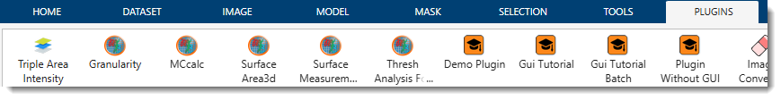
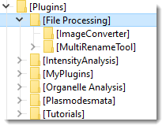

# Plugins

---

## Overview

{align=left}

Plugins in Microscopy Image Browser (MIB) extend its functionality beyond core features, allowing users to customize workflows, integrate new tools, and automate tasks. 
This page provides an overview of how plugins work, how to access them, and a list of commonly used plugins available in MIB.

- Plugins are typically written in MATLAB and stored in the `Plugins` directory of your MIB installation.
- Access plugins via the **Ribbon → Plugins** menu.

---

## Managing plugins

{align=left}

Plugins in Microscopy Image Browser (MIB) are organized in a two-tier structure under the `Plugins` folder within your MIB installation directory (e.g., `C:\MIB\Plugins\`). 

This structure helps categorize and manage plugins efficiently:

- **First Tier (Categories)**: Defines broad plugin categories, such as `File Processing` or `Organelle Analysis`. These are subfolders directly under `Plugins`.
- **Second Tier (Plugins)**: Contains individual plugins within each category folder. For example, the image above shows the `File Processing` category with two plugins: `ImageConverter` and `MultiRenameTool`.

MIB automatically detects and integrates plugins when you start the application, provided they are correctly placed in this structure. 
No additional configuration is typically needed for detection.

The plugins are automatically detected and connected by MIB.
??? warning "Plugins in the compiled version"
    For plugins to work in the standalone (compiled) version of MIB, they must be:

    - **Compiled**: ensure the plugin’s MATLAB code is compiled into a format compatible with the standalone executable (e.g., using MATLAB Compiler).
    - **Included**: Include the plugins into **Files installed for your end user** in the place the original plugin in deploytool of MATLAB
    ??? info "Files installed for your end user"
        {align=left}

    - Once included, MIB will automatically detect and connect these plugins upon launch. Uncompiled `.m` files won’t work in the standalone version without additional setup.

Removing a plugin

To remove a plugin:

* Navigate to the `Plugins` folder in your MIB installation.
* Delete the plugin’s folder (e.g., `Plugins\File Processing\ImageConverter`).
* Restart MIB to update the plugin list.

---

## Available plugins

The table below lists plugins bundled with MIB. 

| Plugin Category        | Plugin Name                                                                      | Description                                                                                                                                                              |
|------------------------|----------------------------------------------------------------------------------|--------------------------------------------------------------------------------------------------------------------------------------------------------------------------|
| **File Processing**    | [**Image Converter**](file-processing/image-converter.md)                        | Batch converts images from [any MIB-supported format](https://mib.helsinki.fi/features_all_fileformats.html) (e.g., NRRD, HDF5) to AM, JPG, PNG, TIF, or XML-header formats. |
|                        | [**Multi Rename Tool**](file-processing/multi-rename-tool.md)                    | Renames multiple files in bulk, with options to adjust digit padding (e.g., `img001` to `img1`) and perform search-and-replace operations.                               |
| **Intensity Analysis** | [**Triple Area Intensity**](intensity-analysis/triple-area-intensity.md)         | Measures intensity across multiple adjacent regions (e.g., different materials) and corrects values using a background reference for accurate analysis.                  |
| **Organelle Analysis** | [**Granularity**](organelle-analysis/granularity.md)                             | Analyzes model granularity, such as the ratio of sheets to tubules in endoplasmic reticulum (ER) morphology, aiding in structural studies.                              |
|                        | [**MCcalc**](organelle-analysis/mccalc.md)                                       | Uses ray-tracing to detect and quantify contacts between organelles (e.g., mitochondria and ER), ideal for spatial relationship studies.                                |
|                        | [**Surface Area 3D**](organelle-analysis/surface-area-3d.md)                     | Computes the surface area of 3D-segmented objects, useful for volumetric analysis of organelles or structures.                                                           |
|                        | [**Thres Analysis for Objects**](organelle-analysis/thres-analysis-for-objects.md) | Analyzes intensity properties of segmented objects with customizable thresholding, enhancing object-specific measurements.                                               |
| **Plasmodesmata**      | [**Cell Wall Thickness**](plasmodesmata/cellwall-thickness.md)                   | Measures plant cell wall thickness in volume electron microscopy datasets, tailored for plasmodesmata research in plant biology.                                        |
|                        | [**Spatial Control Points**](plasmodesmata/spacial-control-points.md)            | Generates sets of random points along an object’s centerline (e.g., plasmodesmata), useful for spatial distribution analysis.                                           |
| **Tutorials**          | [**GUI Tutorial**](tutorials/gui-tutorial.md)                                    | Reference App Designer GUI plugin with four operations (Crop, Resize, Convert, Invert) - the starting point for plugin development.                                     |
|                        | [**GUI Tutorial (Batch)**](tutorials/gui-tutorial-batch.md)                        | The same four operations plus full batch-processing / macro support via the `BatchOpt` system.                                                                          |
|                        | [**Demo Plugin**](tutorials/mib-app-design-plugin.md)                            | Minimal batch-compatible App Designer plugin demonstrating the `BatchOpt` widget-sync system and the three calling modes.                                               |
|                        | [**MIB Plugin Without GUI**](tutorials/mib-plugin-without-gui.md)                | Demonstrates a simple plugin without a graphical interface, focusing on backend functionality for quick scripting.                                                      |

---

## Writing your own plugins

MIB supports custom plugin development in MATLAB. The easiest start is to copy one of the **Tutorials** plugins from `mib\plugins\Tutorials\` and adapt it.
More examples are in the [Programming tutorials](https://mib.helsinki.fi/tutorials_programming.html) section on MIB website.

### Plugins without GUI

The simplest type: a single `.m` file that performs an operation with little or no interaction with the user.

Example: [MIB Plugin Without GUI](tutorials/mib-plugin-without-gui.md)

### Plugins with GUI written using App Designer

[App Designer](https://se.mathworks.com/help/matlab/ref/appdesigner.html) is the recommended framework for plugins with a user interface.

??? info "Examples"
    - [GUI Tutorial](tutorials/gui-tutorial.md) - the starting point for a new plugin
    - [GUI Tutorial (Batch)](tutorials/gui-tutorial-batch.md) - adds support for [Ribbon → Home → Batch processing](../user-interface/ribbon/home/home-batchprocessing.md)
    - [Demo Plugin](tutorials/mib-app-design-plugin.md) - a minimal batch-compatible plugin

!!! warning "GUIDE"
    [GUIDE](https://se.mathworks.com/help/matlab/ref/guide.html), the original MATLAB framework for user interfaces, is being removed from MATLAB. Write new plugins with App Designer.

### Writing plugins with AI coding agents

Plugins can also be written with the help of AI coding agents; MIB3 includes instructions for the agents in `mib\plugins\plugins_instructions.md`.

- [:fontawesome-brands-youtube:{.red-color} Vibe coding a plugin for MIB3](https://youtu.be/ZmeC7fZU0q0)

---

*Back to [MIB](../index.md)*
