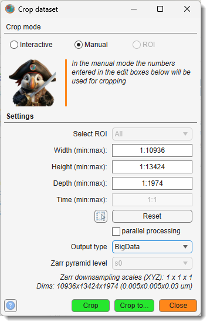

# Crop Dataset

---

{.on-glb align=left}

Crop the image and corresponding Selection, Mask, and Model layers. 

Cropping can be done in:

- Interactive
- Manual
- ROI mode

Demonstration

- [:fontawesome-brands-youtube:{.red-color} Crop dataset demonstration](https://youtu.be/PQtpYUuJwG8)

### Interactive mode

When the **Interactive** mode is selected, you can draw a rectangular area on the image 
by pressing and holding the <mouse class="left"></mouse> button. 
This area defines the region to be cropped.

### Manual mode

Alternatively, enable the <label class="widget widget-checkbox">Manual</label> 
mode to enter specific cropping coordinates directly in the dialog. 

The  button takes those coordinates from the 
image: draw a rectangle exactly as in the Interactive mode and, instead of cropping, 
its coordinates are placed into the edit boxes. The dialog switches to the Manual mode, 
so that the area can be adjusted before cropping.

### ROI-based cropping

You can also crop based on a selected region of interest by enabling the 
<label class="widget widget-checkbox">from ROI</label> mode, 
which uses ROIs defined in the [ROI panel](../../panels/roi/index.md).

### Start cropping

To perform the crop, click the Crop button to 
crop the current dataset.  
Alternatively, use the 
Crop to button to copy the cropped dataset
to another buffer. Buffers are managed via the buttons at the top of 
the [Datasets panel](../../panels/datasets/index.md).

!!! note
    To restore a cropped dataset into the original, use the **Fuse into existing** mode 
    of **Dataset Chunking → Stitch dataset** available at 
    [Ribbon → Home → Dataset Chunking → Stitch dataset](../home/home-choppedimages.md#dataset-chunking-stitch-dataset).

---

## BigData datasets

When the active dataset is a **BigData** (OME-Zarr v3 pyramidal) dataset, additional 
controls become available in the **Settings** panel of the Crop dialog.

Only the requested region is read, so cropping a small area of a very large or remote 
dataset costs no more than the area itself.

!!! note
    Cropping a BigData or Virtual dataset cannot be undone. Crop into another 
    container from the Destination dropdown 
    to keep the original.

### Zarr pyramid level

The Zarr pyramid level dropdown selects which 
resolution level of the pyramid is used as the source for the crop region.
Level **s0** is the full-resolution data; **s1**, **s2**, … are progressively 
downsampled versions (e.g. s1 is typically 2× downsampled in XY).

The label below the dropdown shows the downsampling factors (XYZ) of the selected level
and the dimensions and voxel size the cropped dataset will have at that level.

!!! tip
    Choosing a coarser pyramid level (s1, s2, …) produces a smaller in-memory 
    dataset but with proportionally larger voxel sizes.

### Output type

The Output type dropdown controls what 
format the cropped data is saved in. It is enabled only when the source dataset is BigData.

#### Standard

The cropped region is loaded from the selected pyramid level into memory as a 
**Standard** (in-memory) dataset. The resulting dataset resides entirely in RAM and 
can be worked on with all standard MIB tools.

The voxel size of the output reflects the selected pyramid level - cropping at s1 
doubles the voxel size relative to s0.

Before cropping, MIB checks that the cropped area fits into the free memory of the computer. If it 
does not, nothing is cropped and a message shows how much memory is needed and how much is free. 
In that case, do one of the following:

- select a coarser Zarr pyramid level (s1, s2, ...), which 
  makes the crop smaller;
- crop a smaller area;
- set Output type to **BigData**, which writes the crop to disk 
  instead of loading it into memory.

#### BigData

The cropped region is written to a **new OME-Zarr v3 pyramid** on disk. A file-save 
dialog appears to choose the destination `.zarr3` folder, followed by the Zarr settings 
dialog filled in with the settings of the source pyramid (pyramid levels, chunk size, 
sharding, downsampling strategy). Keep them so that each level of the crop has the scale 
of the same level of the source, or change them before writing.

!!! warning
    A confirmation dialog is shown before the file picker because this operation writes 
    a new pyramid to disk and replaces the dataset in the destination buffer.

MIB reads and writes the cropped area piece by piece, so the crop can be larger than the 
memory of the computer. The crop is always written at full resolution (level s0).

The BigData output writes one time point. For a time series, set 
Time (min:max) to a single time point, for example `3:3`.

**Faster cropping with several processor cores**

Check parallel processing to let several processor cores 
read and write the image at the same time. This is faster for large crops.

- The checkbox is available only when the dataset is BigData and *Output type* is **BigData**.
- If no parallel pool is running, MIB starts one first, which takes a few seconds. You can also start 
  and stop the pool yourself from *Home ribbon -> Preferences -> Parallel pool*.
- The model is always copied by one core, also with this checkbox.

**Stopping a crop and finishing it later**

If you press Cancel while the image is written, MIB asks 
whether to keep the unfinished crop:

- Keep leaves the part written so far on disk. To finish it, 
  crop the same area again, save it to the same `.zarr3` folder, keep the same Zarr settings, and 
  choose Resume when MIB asks.
- Delete removes the unfinished crop from the disk.

If the crop stops because of an error, the part written so far is kept in the same way, and the 
error message tells you so.

!!! warning
    If you press **Cancel** while the model is copied, the image of the crop is already complete and 
    stays on disk, but the model is not: MIB deletes the unfinished model and does not open the crop. 
    Crop again to get the image together with its model.

**Output files created:**

| File | Contents |
|------|----------|
| `<name>.zarr3` | OME-Zarr v3 image pyramid (always written) |
| `Labels_<name>.zarr3` | Packed segmentation model pyramid - only created when a BigData model exists in the source dataset |

The model pyramid (`Labels_<name>.zarr3`) is written at full resolution (s0) and all 
coarser levels are derived automatically. Material names, colors, and material count 
are copied from the source model.

After writing, the cropped BigData dataset is loaded into the destination buffer 
automatically. If a model was written, it is attached to the buffer immediately - 
no manual model loading is required.

The output zarr3 file is highlighted in the **Directory Contents** panel after the 
operation completes.

!!! note
    The source BigData file on disk is **not** modified or deleted. Only the 
    destination buffer is updated.

---

*Back to [MIB](../../../index.md) | [User interface](../../index.md) | [Ribbon](../index.md) | [Dataset](index.md)*
