# Sharpness and Noise

---

## Description

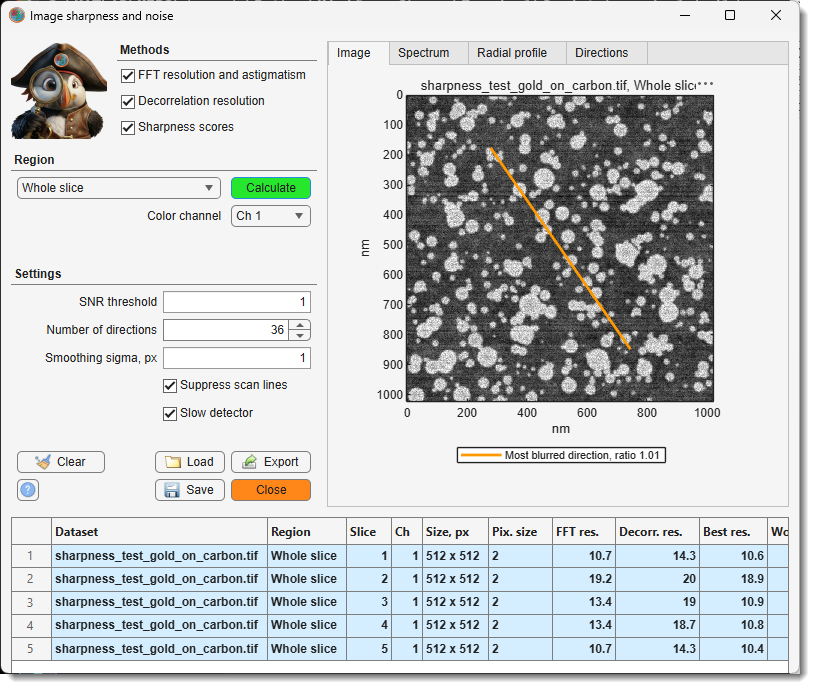{.on-glb align=right width="300"}

Measures the resolution and the noise of selected areas of the current slice, detects astigmatism
and gives focus scores. Every calculation adds rows to the results table, so different images,
slices or microscope settings can be compared side by side. The table is kept until MIB is closed.

The analysed area should hold even, unstructured texture: a gold-on-carbon test specimen,
cytoplasm or embedding resin. Membranes, fibres, edges and other oriented structures are read as
astigmatism. Use at least 256 x 256 pixels for stable values.

## Methods

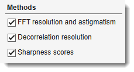{align=right}

Tick the methods to calculate; each fills its own columns of the results table.

- FFT resolution and astigmatism - from the power
  spectrum of the area[^1]: the finest detail that still stands out from the noise, overall and
  in each direction, and the noise of the image.
    - **FFT res.** - the resolution.
    - **Best res.**, **Worst res.** - the resolution in the sharpest and in the most blurred
      direction.
    - **Astig. ratio** - worst divided by best resolution; 1 means no astigmatism.
    - **Astig. angle** - the most blurred direction, counterclockwise from horizontal; it is the
      direction of the streaks seen in an astigmatic image. With astigmatism it turns by about 90
      degrees when the focus passes from under- to overfocus.
    - **Noise SD** - the noise in grey values.
    - **SNR, dB** - the signal-to-noise ratio of the whole area, signal power over noise power, in
      decibels: 0 dB means equal power, 10 dB ten times, 20 dB a hundred times more signal than
      noise.

- Decorrelation resolution - an independent estimate
  of the resolution[^2] (**Decorr. res.**), less affected by noise, without directions. When it
  differs a lot from the FFT value, or gives no value, the area does not suit the method; rely on
  the FFT value.
- Sharpness scores - two focus scores without
  units[^3] (**Grad. energy**, **Lapl. var.**), higher is sharper. Use them only to rank images of
  the same specimen, for example a focus series.

## Region

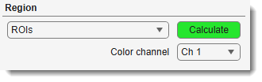{align=right}

The dropdown selects which part of the current slice is analysed, and the button next to it
starts the analysis: Calculate, or
Draw for **Drawn rectangle**. Every analysis adds its
results to the table; a long one can be stopped with **Cancel**, and nothing is added then. All
modes use the image at its full resolution, whatever the zoom of the image view.

- **Drawn rectangle** - a rectangle drawn on the image. Press
  Draw, drag over the image, adjust the rectangle if
  needed and double-click inside it; the area is analysed straight away (++escape++ cancels).
  The next press of Draw shows the previous rectangle
  again when it is in view: double-click it to analyse the same area again, for example on
  another slice or with other settings, or move and resize it first. To cancel at that point,
  delete the rectangle from its right-click menu. After switching to another dataset or
  orientation a new rectangle is drawn.
- **Mask layer** - every separate object of the mask on the current slice gives its own row; the
  rectangle enclosing each object is analysed. Useful to keep the analysed areas while the
  selection layer is used for other work.
- **ROIs** - every ROI of the current orientation is analysed and gives its own row, named after
  the ROI label. ROIs are defined in the [ROI panel](../../panels/roi/index.md); the rectangle
  enclosing each ROI is analysed. Use several ROIs across the field of view to see whether the
  focus or the astigmatism changes from the centre to the edges.
- **Selection layer** - the same as **Mask layer**, for the objects of the selection layer. A
  quick way to mark several areas without creating ROIs: draw them with any selection tool.
  Objects smaller than 64 x 64 pixels are skipped.
- **Shown area** - the part of the slice visible in the image view. Zoom and pan to the area of
  interest, then press Calculate. The quickest way to
  check a spot.
- **Whole slice** - the complete slice. A large slice takes longer, and usually mixes structures
  of different orientation, so prefer a smaller area for astigmatism.

Color channel selects the channel to analyse in
multichannel images.

## Settings

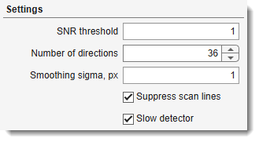{align=left}

- SNR threshold - decides where the FFT method puts the
  resolution limit. Fine details of an image correspond to high spatial frequencies, coarse
  structures to low ones. The method works in three steps:

    1. It averages the power of the image at each spatial frequency; this is the blue curve of
       the **Radial profile** tab.
    2. It measures the noise floor: the power of the noise alone, at the highest frequencies,
       where an image holds no signal.
    3. Going from coarse to fine detail, it compares at each frequency the signal (the power above
       the noise floor) with the noise floor. The first frequency where this ratio drops below the
       threshold, and stays below it, is the cutoff. The resolution is one period of that
       frequency: 1 / cutoff.

    What the values mean:

    - **1** (default) - the cutoff is where signal and noise are equally strong.
    - **0.5** - accepts detail with half as much signal as noise; finer resolution numbers.
    - **2** - requires twice as much signal as noise; coarser resolution numbers.

    The threshold is applied frequency by frequency; it is not the **SNR, dB** of the whole area.
    Keep the same value for all images that are compared.

    ??? example "Example: three thresholds on the same image"

        The cutoffs of thresholds 0.3, 1 and 4 give 8.9, 10.6 and 13.2 nm:

        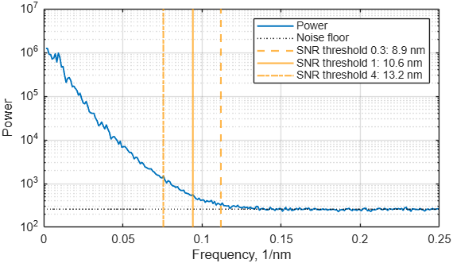{.on-glb width="560"}

- Number of directions - in how many directions between 0
  and 180 degrees the FFT resolution is measured for the astigmatism, up to 72. More directions
  sample the angle more finely, but each direction rests on fewer data and its value is noisier;
  the default 36 measures every 5 degrees.

    ??? example "Example: 12 and 72 directions on an astigmatic image"

        Both settings find the same astigmatism:

        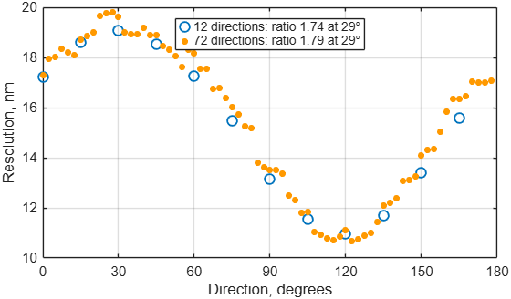{.on-glb width="560"}

- Smoothing sigma, px - light blurring before the
  sharpness scores, which reduces the effect of noise on them; `0` turns it off. It does not
  affect the resolution values. Compare scores only when they were calculated with the same
  value.

    ??? example "Example: the same area with sigma 0, 1 and 2"

        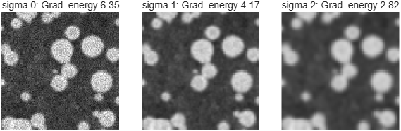{.on-glb width="560"}

- Suppress scan lines - keep it on for scanned images
  (SEM, FIB-SEM, STEM, confocal); line-to-line intensity jitter would otherwise look like
  astigmatism along the scan direction.

    ??? example "Example: a sharp image with scan-line noise"

        The orange ellipse is the resolution limit in each direction; with the setting off the
        stripes stretch it along the vertical axis:

        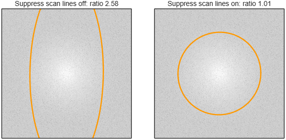{.on-glb width="560"}

- Slow detector - tick it when the detector is slow
  for the scan speed, so each pixel still holds part of the previous one and the noise is smeared
  along the scan lines. Without it such images get a far too fine **FFT res.**, a too high
  **SNR, dB** and a false astigmatism along the scan direction. MIB recognises these images and
  asks to tick the box; the scan lines have to run horizontally.

    ??? example "Example: the focused test slice recorded with a slow detector"

        With the setting off the noise floor (dotted) lies too low and the cutoff moves far to the
        right; with it on, the result is that of the same image from a fast detector:

        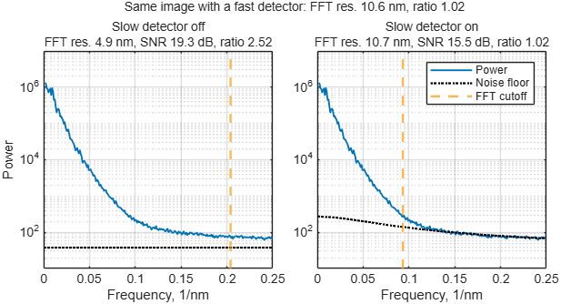{.on-glb width="560"}

## Buttons

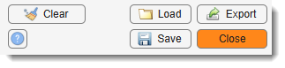{align=right}

- Clear - removes all rows from the results table, after
  confirmation.
- Save - saves the results table, with all plots, to a
  `.mibSharp` file.

- Load - opens a `.mibSharp` file. When the table
  already holds measurements, the loaded ones are added after them or replace them.

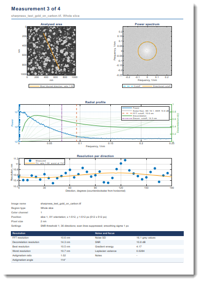{.on-glb align=right width="250"}

- Export - tick any combination of outputs; the files
  share one base name, each with its own extension:
    - **Excel table (.xlsx)**, **CSV table (.csv)** - the results table as shown.
    - **MATLAB file with all curves (.mat)** - the table and all spectra and curves.
    - **Report, Word (.docx)**, **Report, PDF (.pdf)** - a report in A4 portrait: a summary table
      first, then one page per measurement with the analysed area and its spectrum, the radial
      profile, the resolution per direction, a description of the area and the measured values.
      Writing it takes a few seconds per measurement.
    - **Export to MATLAB workspace** - the same as the MATLAB file, as a variable with the name
      given below the checkboxes; only in MIB for MATLAB.

    The export can be cancelled; files written before that are kept.

- ? - opens this page.
- Close - closes the window; the results table and the
  settings are back when it is opened again in the same MIB session.

## Reading the results

| Column | Meaning |
|---|---|
| **Dataset** | file name of the dataset |
| **Region** | the analysed area: *Shown area*, *Whole slice*, *ROI* with its label, *Selection* or *Mask* with the object number, or *Rect* with the pixel range of the drawn rectangle |
| **Slice** | slice number in the shown orientation |
| **Ch** | color channel |
| **Size, px** | width x height of the analysed area |
| **Pix. size** | pixel size, *x x y* when they differ |
| **FFT res.** | resolution from the power spectrum |
| **Decorr. res.** | resolution from the decorrelation analysis |
| **Best res.**, **Worst res.** | resolution in the sharpest and in the most blurred direction |
| **Astig. ratio** | worst divided by best resolution; 1 means no astigmatism |
| **Astig. angle** | most blurred direction in degrees, counterclockwise from horizontal |
| **Grad. energy**, **Lapl. var.** | focus scores without units, higher is sharper |
| **Noise SD** | noise in grey values |
| **SNR, dB** | signal-to-noise ratio of the area in decibels; *-Inf* when no signal stands out from the noise |
| **Units** | unit of the resolution and pixel size values: nm when the dataset has its pixel size in length units |
| **Note** | *FFT: pixel-limited* - detail reaches the pixel size, the true resolution may be finer than the 2 pixels reported; record with smaller pixels to measure it. *some directions pixel-limited* - the same for some directions, so the astigmatism ratio may be too low. *FFT: slow detector, not valid* - the noise is smeared along the scan lines; tick [Slow detector](#settings) and calculate again. *Decorr.: no peak* - the decorrelation analysis found no resolution; use the FFT value |

A column stays empty when its method was switched off. The table keeps the measurements of all
datasets for comparison; the rows of the active dataset are highlighted.

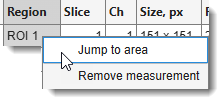{align=right}

Right-click the table for:

- **Jump to area** - shows the area of the selected row in the image view, on its slice and
  time point; the zoom is kept. The dataset the row was measured on has to be the active one,
  in the same orientation.
- **Remove measurement** - removes the selected rows from the table.

???+ warning "warning"

    - The resolution values depend on the noise as well as on the sharpness: compare images with
      similar **SNR, dB**, and keep the settings the same between the compared rows.
    - **SNR, dB** and the resolution values assume that the noise of neighbouring pixels is
      independent, or smeared along the scan lines only by a slow detector
      ([Slow detector](#settings)). Images that were filtered, denoised, compressed, resampled or
      averaged along the scan lines show a too high SNR and a too fine resolution; analyse the
      images as they come from the microscope.

## Plot tabs

Click a row of the results table to show it in the tabs. The examples below are slice 3 of the
test image, an astigmatic image with the most blurred direction at 30 degrees.

- **Image** - the analysed area, with the contrast of the image view at the time of the
  calculation. When the FFT method was used, an orange line through the centre marks the most
  blurred direction (**Astig. angle**); it runs along the streaks of an astigmatic image. The
  length of the line has no meaning.

    ??? example "Example: Image tab"

        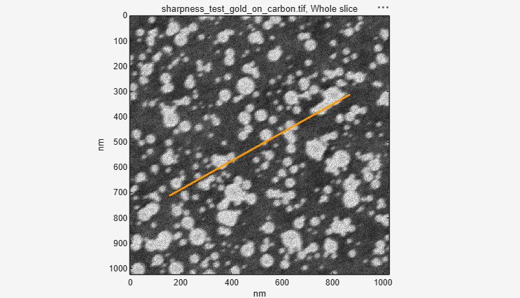{.on-glb width="480"}

- **Spectrum** - the power spectrum of the area, with the same orientation as the image. The
  centre holds the coarse structures, the edge the finest detail the pixel size allows; the
  brighter a point, the more of that detail the image contains. Where the bright area ends, the
  signal ends and only noise is left. The frequency axes are in 1/nm: a limit at 0.1 1/nm means
  10 nm resolution.
    - **Cutoff** (dashed blue circle) - the overall resolution limit, **FFT res.**
    - **Directional cutoff** (orange curve) - the limit in each direction. A round curve means no
      astigmatism; an ellipse means astigmatism, and its short axis points along the most blurred
      direction.

    ??? example "Example: Spectrum tab"

        The orange ellipse is short along 30 degrees, the most blurred direction:

        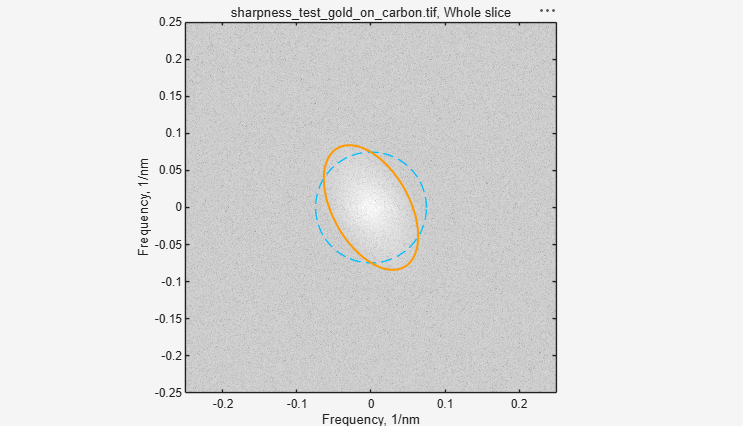{.on-glb width="480"}

- **Radial profile** - the frequency content of the area as curves. The horizontal axis runs from
  coarse structures on the left to the finest possible detail on the right.
    - **Power** (blue, left axis) - how much of each detail size the image contains. It falls
      towards finer detail until it meets the **Noise floor** (grey dotted), the level of pure
      noise; the legend gives the noise SD and the SNR of the area.
    - **FFT cutoff** (orange-red dashed) - where the power is no longer above the noise floor by the
      [SNR threshold](#settings); its position gives **FFT res.**
    - **Decorrelation** (green, right axis) - the curves of the decorrelation analysis. The solid
      curve is calculated from the original image, the pale ones from versions with the coarse
      structures removed. A curve rises while it collects signal and falls where noise takes over;
      its peak marks where the signal ends.
    - **Decorr. cutoff** (purple dash-dot) - the highest-frequency peak of all decorrelation
      curves; its position gives **Decorr. res.**

    Both vertical lines estimate the same limit and normally lie close together. When they lie far
    apart, the shape of the blue curve tells which method to trust:

    - **Decorr. cutoff** far left of **FFT cutoff**, and the blue curve falls evenly into the noise
      floor without a bend - the decorrelation analysis fails. This is typical of images whose
      pixels are coarser than the real resolution; it found a false peak at coarse detail. Use
      **FFT res.**
    - **FFT cutoff** far right of **Decorr. cutoff**, often at the right edge (*pixel-limited*),
      and the blue curve keeps falling at the finest detail instead of running flat along the noise
      floor - the noise is not independent between pixels. With *FFT: slow detector, not valid* in
      **Note**, tick [Slow detector](#settings). Otherwise the image was filtered, compressed or
      resampled: the FFT method then reports a far too fine resolution, and the decorrelation
      analysis is not reliable either. Analyse an unprocessed image.

    ??? example "Example: Radial profile tab"

        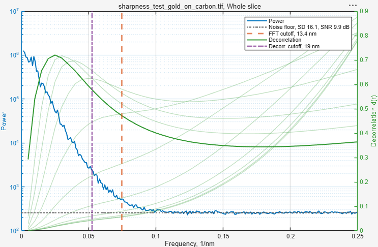{.on-glb width="640"}

- **Directions** - the resolution in each direction (blue dots; open circles where the detail
  reaches the pixel size) and the fitted curve (orange). A flat curve means no astigmatism. With
  astigmatism the curve forms a wave: its maximum is at the most blurred direction
  (**Astig. angle**, **Worst res.**), its minimum 90 degrees away (**Best res.**), and the ratio
  of the two is the **Astig. ratio**.

    ??? example "Example: Directions tab"

        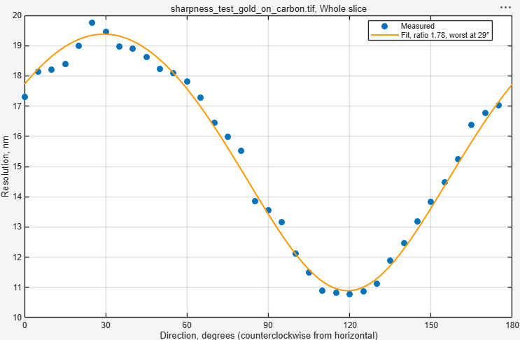{.on-glb width="640"}

!!! tip "Test image"

    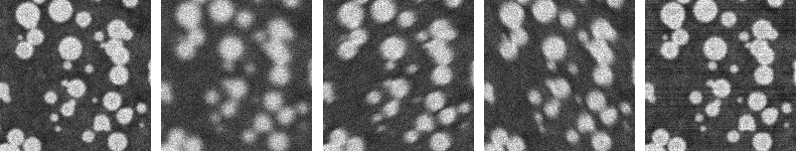
    
    

    `assets\misc\sharpness_test_gold_on_carbon.tif` in the MIB folder is a simulated gold-on-carbon
    specimen with 2 nm pixels, recorded five times: 1 - focused, 2 - defocused, 3 and 4 - astigmatic
    on either side of focus (most blurred at 30 and 120 degrees), 5 - focused with scan-line noise.
    Open it and compare the slices with **Whole slice**.

[^1]:
    Postek M.T., Vladar A.E. (1998) Image sharpness measurement in scanning electron microscopy -
    Part I. *Scanning* 20, 1-9. [doi:10.1002/sca.1998.4950200101](https://doi.org/10.1002/sca.1998.4950200101)
[^2]:
    Descloux A., Grussmayer K.S., Radenovic A. (2019) Parameter-free image resolution estimation
    based on decorrelation analysis. *Nature Methods* 16, 918-924.
    [doi:10.1038/s41592-019-0515-7](https://doi.org/10.1038/s41592-019-0515-7)
[^3]:
    Pertuz S., Puig D., Garcia M.A. (2013) Analysis of focus measure operators for
    shape-from-focus. *Pattern Recognition* 46, 1415-1432.
    [doi:10.1016/j.patcog.2012.11.011](https://doi.org/10.1016/j.patcog.2012.11.011)

---

*Back to [MIB](../../../index.md) | [User interface](../../index.md) | [Ribbon](../index.md) | [Image](index.md)*
